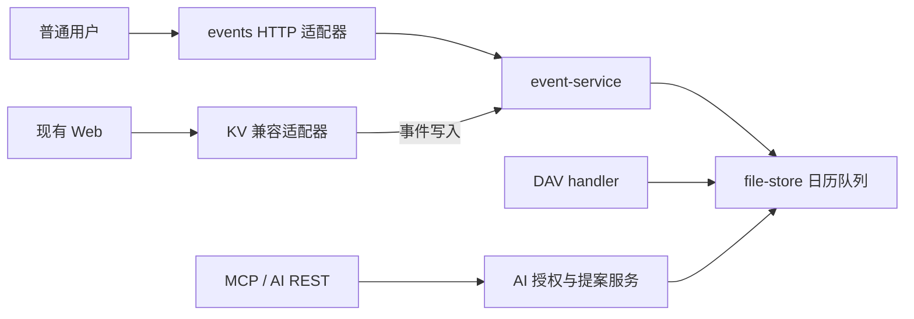

# SimpleCal 通用服务器演进

## 已实施的边界

`event-service` 承担普通用户事件的模型转换、读取、创建、部分修改、删除与 ETag 前置条件。
KV 的事件写入调用该服务的兼容方法；设置、通用 KV 与 VTODO 保留原逻辑。
HTTP 适配器处理路径、方法、JSON 与响应，复用日历接口的账号认证和 CSRF 边界。
存储层在日历队列内完成条件检查与提交，DAV MOVE 使用持久化日志支持启动恢复。

CardDAV 使用独立地址簿存储，不与事件 JSON 混用。分享链接只授予完整日历或忙闲只读能力。
AI 的日历授权、时间窗、字段裁剪和删除提案策略保持独立，不通过普通用户事件 API 绕过。

## 当前验证范围

- 普通用户事件 API 与 KV/DAV 可互操作，账号隔离和并发版本检查有效。
- 通用运行包首启、登录、重启持久化与产物联调通过。
- DAV 条件写入、MOVE、CardDAV、分享链接和公开子路径具有集成回归。
- AI REST 与 MCP 回归通过。
- Linux/systemd/Docker 的目标平台实测仍需在对应环境完成。

通用运行目录默认命名为 `dist/SimpleCal-server-<版本>/`。

## 后续工作

1. 补齐事件字段的机器可读 schema、复杂规则校验和范围查询契约。
2. 增加分页、重复实例查询与例外编辑语义；先定义边界再开放参数。
3. 根据契约逐步将前端从 KV 迁往领域 API，保留兼容适配器。
4. 在 Linux、Docker 与 ARM/x86 上验证部署和恢复流程。
5. 如实测出现需要，再决定索引、跨进程锁或数据库方案。

当前仍是单写入进程文件存储。列表未分页，JSON 转换并非任意 ICS 扩展属性无损编辑。
