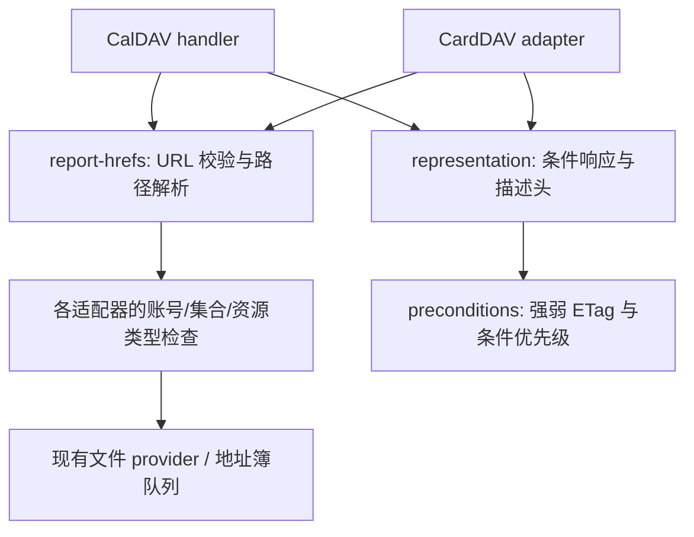

# CalDAV 实现对照与架构改进

日期：2026-10-30。SimpleCal 基线：`79050b8`。

后续开发已推进至批量读取、分页、领域服务和本地协作。本文保留首轮对照及各阶段历史，
当前完成度、最新性能及剩余阻塞请以 [实施状态](IMPLEMENTATION_STATUS.md) 为准。

## 范围与证据

本轮完成 Radicale 的本地运行探测和 REA 证据解析，以及 sabre/dav、Nextcloud 的定点源码对照。不是所有主流服务器的完整逆向，也不是客户端兼容性认证。第三方程序和源码留在系统临时目录，SimpleCal 没有增加运行依赖或复制第三方实现。

| 对照对象 | 固定身份 | 方法与边界 |
| --- | --- | --- |
| Radicale | PyPI `3.9.0`；Python `3.15.0`，Windows | 实际加载安装包，通过临时 WSGI HTTP 服务执行 13 次请求；REA 离线解析 HAR。仅 synthetic 数据，auth=none，绑定 loopback，临时存储自动删除；不验证认证、生产部署或 Linux 文件锁 |
| sabre/dav（Baïkal 底层框架） | `4.7.0`，commit `074373bcd689a30bcf5aaa6bbb20a3395964ce7a` | 普通源码阅读；没有 PHP 运行时，未运行 Baïkal 或 sabre/dav，不能推出整套服务器的运行结果 |
| Nextcloud Server | `v32.0.0`，commit `5ee29decb00508122f008abacea26fb3e122b13c` | 普通源码阅读 `apps/dav/lib/CalDAV/CalDavBackend.php`；没有启动 Nextcloud，不代表最新版或所有数据库行为 |

Nextcloud 文件 SHA-256：`24fcbe646895141fe87440960fd14b5ca311642e3c799bbf10944eca0660e9fb`。Radicale 的全部 Python 文件摘要及依赖版本见 [安装包身份](evidence/radicale-3.9.0.identity.json)、[环境版本](evidence/radicale-environment.txt)。

REA 原始证据 ID：`ev_c2b826ecbf904b0610807d3f938570cd08fbe1407505f1fa4b254468c8067004`。
完整记录视图：`ev_b58af7492a5b9e51c164de10df4501004a34b930deeeb260a26a779ac4af2ea1`（ordinal 6–11）。

证据已保存为 [HAR](evidence/radicale-3.9.0.har) 和 [REA bundle](evidence/rea-radicale.json)。HAR SHA-256：`ff3d94f96ee24b6847801eb5b8b9ee857dcaf718269f2f026f211b9a05d0bd15`。
REA 的 authority 是 `historical-reference`：它验证并解析已记录的捕获，没有亲自证明捕获来自哪个正在运行的进程。运行归属由本地探测脚本、安装包身份与命令输出支持。HAR 时间字段为占位值，不能用于性能结论。

## 发现清单

| 问题 | 证据及观察 | SimpleCal 决策 | 状态 |
| --- | --- | --- | --- |
| multiget 是否限制集合？ | Radicale ordinal 9 返回本集合对象；ordinal 10 对其他集合对象返回 207 内的 404 | 修复 CalDAV 直接按 href 读存储的旁路；要求报告目标为日历，并验证 href 的账号和集合与目标一致 | 已实现并验证 |
| 是否应信任 href 的任意 origin？ | Radicale ordinal 11 接受外部 origin、使用其 pathname；没有证据表明发生网络请求 | 设计选择：仅允许请求 origin 和显式配置的 public origin；不复制这个宽松行为，不发起外部请求 | 已实现并验证 |
| GET/HEAD 是否有条件缓存？ | Radicale ordinal 6、7 的 If-None-Match 命中、ordinal 8 的陈旧 If-Match 均返回 200；不能据此声称 Radicale 实现了这些读取条件 | sabre/dav Server 集中处理前置条件；复用 SimpleCal 现有强弱 ETag 解析器，为 CalDAV 对象增加条件读取，共用 CardDAV 与集合导出的响应构造 | 已实现并验证；农历投影限制见下文 |
| 如何解析公开地址？ | sabre/dav `calculateUri` 与 base URI 边界；SimpleCal 原有 CardDAV 单独处理 origin，CalDAV 使用硬编码 localhost | 提取公共 REPORT href 解析，支持集合相对 href、内部路径、公开绝对路径、公开子路径；在 URL 规范化前拒绝点段与编码分隔符 | 已实现并验证 |
| 存储与协议如何分离？ | Nextcloud `getMultipleCalendarObjects` 按 calendarid 限定、每 100 个 URI 批处理；`calendarQuery` 使用索引候选及后过滤 | 先抽取无持久化依赖的协议公共逻辑，保持现有 provider；将批量读取、范围候选查询列为后续 provider 契约，不立即更换数据库 | 局部完成 |
| 同步日志如何设计？ | sabre/dav SyncSupport 接口；Nextcloud `addChanges` 在 atomic 块中写 calendarchanges 并递增 synctoken | 保留 SimpleCal 的每日历队列、墓碑和 MOVE 恢复；以后引入数据库时要求对象和日志同事务提交 | 已分析，数据库实现未开展 |
| 重复事件、复杂过滤、调度是否对齐？ | 本轮没有覆盖这些第三方运行路径；SimpleCal calendar-query 当前仅抽取组件和时间范围 | 单列后续验收，不宣称已对齐 | 未解决 |

SimpleCal 原有缺口的具体影响：`calendar-multiget` 中直接 `store.getEvent(resolved.calendar, resolved.file)`，没有核对 `resolved.username`、目标集合或 hydrate 隐藏检查。同账号可在可见日历的 REPORT 内请求隐藏日历数据；其他用户名的 href 也会被错误解释为当前请求账号的数据路径。账号隔离由 request context 保持，本轮没有证据证明能读出其他账号的实际存储。

## 已落地架构



`report-hrefs.mjs` 只做输入解析与 URL 边界；不查账号、不读磁盘、不访问网络。
`representation.mjs` 只构建状态码、描述头与正文；认证与隐藏/只读策略仍由适配器执行。
href 越界、语法异常、跨集合或资源缺失分别作为 207 内的 404；错误 href 不再导致整份报告 500。

普通对象 GET/HEAD 的 If-None-Match 弱比较命中返回 304，陈旧或弱 If-Match 返回 412，非法标签返回 400。If-Match 优先。304 的 Content-Length 描述正常 200 表示的长度，响应无正文。农历每年重复对象保留完整读取，不按源 ETag 返回 304，并设置 Cache-Control: no-store，避免新增错误缓存。

本轮没有修改存储格式、账号认证、CSRF、AI 授权或写队列。没有迁移数据的步骤。

## 验证与限制

执行命令（从 `code/`）：

```powershell
node --test app/test/dav-read-contract.test.mjs app/test/dav-protocol.test.mjs app/test/carddav.test.mjs app/test/public-url.test.mjs app/test/dav-move.test.mjs app/test/events-api.test.mjs app/test/storage-provider.test.mjs app/test/shares.test.mjs
node app/test/m8-0212-lunar.test.mjs
```

首组 13 个测试通过；农历模块 33 个断言通过。新增两项集成测试覆盖条件 GET/HEAD、标签列表/强弱比较、更新后失效、公开/内部/相对 href、隐藏集合、假用户名、外部 origin、路径穿越和非法 URL；同样验证 CardDAV。既有 MOVE、普通用户 API、分享和 provider 回归通过。没有执行完整前端、真实日历客户端、容器或 Linux 回归。

既有特殊边界仍需后续解决：农历每年重复在读取时动态计算 RDATE，但存储 ETag 和 sync-token 基于原始对象。本轮阻止此类对象进入新增的 304 缓存路径，并测试其完整读取；跨年后投影变化未必推动同步版本，本轮没有解决这套投影/同步版本契约。不能把普通事件的缓存测试解释成农历跨年同步认证。Last-Modified/If-Modified-Since 读取条件本轮也未新增。

## 后续工作与验收顺序

### 第 2 阶段开发进展（2026-10-30）

农历 RDATE 从读取适配器的临时投影改为存储队列内物化：列表、对象、集合快照、ctag、
sync-token 与增量查询在提供结果前刷新；条件变更和 MOVE 在检查版本前刷新。
写入也先规范化 RDATE，返回的 ETag 对应实际存储内容。HTTP GET/REPORT/导出使用同一内容，
恢复农历对象的 304 缓存。前文第 1 阶段的 no-store 临时限制已被此实现替代。
只读诊断模式禁止物化写入；在线只读日历仍允许服务端维护投影，不改变客户端权限。

新增可控时钟的跨农历年度集成测试，验证 GET/REPORT/getetag、导出、增量 token、
旧 If-Match 拒绝、并发重复读取不重复增加版本、重启后版本保持以及新版本条件写入。
时钟由 2026-12-31 推进至 2027-03-02，跨过农历年度边界；公历 1 月 1 日并不必然
改变农历展开窗口。12 项关联回归全部通过；既有存储脚本 18 项断言通过。

当前按访问惰性物化，仍受原文件存储的原子文件写入和单进程队列保证约束，不新增跨文件
数据库事务承诺。为保证正确性，对象读取会检查集合对象；下一阶段需测量并优化批量读取，
避免大集合反复扫描。第 3–7 阶段仍待实施。

### 第 1 阶段开发进展（2026-10-30）

已实现有界严格 XML 解析、命名空间感知的 REPORT/PROPFIND 分发和属性解析、
规定父节点下的直接控制节点选择，以及独立 calendar-filter 查询模块。
已支持组件、属性、参数存在性和文本筛选、ASCII/octet 比较及有限 UTC 范围查询。
不支持的复杂条件返回明确错误；格式和结构不合法返回 400。
具体支持范围及重复事件限制以 [DAV 接口](../DAV_API.md) 为准。

固定 Radicale 3.9.0 的 12 项查询通过独立 loopback HTTP 探测，
SimpleCal 集成测试按相同合成 fixture 逐项比较状态码及 UID 集合，全部一致。
17 次交互保存为 [查询 HAR](evidence/radicale-query.har)，
逐项观察结果见 [结果矩阵](evidence/radicale-query.results.json)。
HAR SHA-256 为 `d27c4ef54457f72eb7b5cb8154b57dc8bdbec574a69f067cf9ad72f68025b3c0`。
REA 原始证据为 `ev_033cb978516ce457731a3d21b03180106c7973378fb4778fc1eaf3f7d5fe3dae`，
保存于 [查询证据 bundle](evidence/rea-query.json)；与首轮相同，离线 HAR 解析不独立证明运行归属。

验证：32 项相关单元/集成测试通过；修订开放重复时间范围的明确拒绝契约后，
重跑受影响的 15 项过滤/查询/XML 边界测试全部通过；既有 protocol-m34 的 20 项通过。
真实客户端、完整前端及容器回归尚未执行。第 2–7 阶段仍待实施。

1. **协议正确性**：命名空间感知的 REPORT/PROPFIND 解析、复杂 comp-filter/prop-filter/text-match 语义；暂未支持的过滤应明确拒绝。验收：相同事件集下与固定参考版本的查询结果逐项比较，包含无效 XML 和相同 localName 的其他命名空间。
2. **统一同步版本**：定义原始 ICS、JSON 视图、农历投影和展开实例的版本关系；确保年份推进会使相关缓存与同步失效。验收：冻结时钟跨年，比较 GET、REPORT、getetag、sync-token 与条件写入。
3. **批量和范围查询**：provider 增加受 calendarId 限制的批量读取与候选查询契约；固定快照和内存预算，先测 1k/10k 对象，再决定索引或 SQLite。验收：结果一致、并发写入无漏报、有可复现的时间和内存基线。
4. **可恢复的有界同步**：先定义 limit/续传令牌和快照水位，避免截断响应却发布最终 token。验收：分页期间 create/update/delete/MOVE/重启无永久漏项。
5. **领域服务合流**：逐步让 DAV、KV、普通用户 API 共用事件约束；AI 保留独立授权和提案策略。验收：三种入口并发写同一 ETag 仍只有一个成功，未知 ICS 属性按明确契约保留。
6. **协作功能**：按需实现邀请调度/iTIP/iMIP、日历用户 ACL、委托；分享令牌不等同于 ACL。需要独立模型、权限测试和投递失败策略。
7. **扩展参考与客户端**：补 SOGo、DAViCal、独立 Baïkal 运行探测，以及 Thunderbird、DAVx5、Apple Calendar 的同步场景。当前都未开展。

## 源码与官方资料

- [sabre/dav 4.7.0 CalDAV Plugin](https://github.com/sabre-io/dav/blob/074373bcd689a30bcf5aaa6bbb20a3395964ce7a/lib/CalDAV/Plugin.php)：`calendarMultiGetReport`，425 行起。
- [sabre/dav 4.7.0 Server](https://github.com/sabre-io/dav/blob/074373bcd689a30bcf5aaa6bbb20a3395964ce7a/lib/DAV/Server.php)：`calculateUri` 与 `checkPreconditions`，后者 1289 行起。
- [Nextcloud 32.0.0 CalDavBackend](https://github.com/nextcloud/server/blob/5ee29decb00508122f008abacea26fb3e122b13c/apps/dav/lib/CalDAV/CalDavBackend.php)：批量读取 1299、查询 1751、同步增量 2556、变更记录 2992 行起。
- [sabre/dav SyncSupport 说明](https://sabre.io/dav/sync/)；[Radicale v3 文档](https://radicale.org/v3.html)；[Nextcloud provider 接口说明](https://docs.nextcloud.com/server/stable/developer_manual/digging_deeper/groupware/calendar_provider.html)。在线 stable 文档会变化，定点源码结论以上述 commit 为准。

## 复现捕获

在隔离 Python 环境安装记录中的 Radicale 与依赖版本后：

```powershell
python code/scripts/probe-radicale.py <绝对输出路径>/radicale.har
```

该脚本启动自己的 loopback 服务、生成合成事件、执行请求、停止服务，输出 HAR 和安装包文件摘要。再调用 REA `inspect_web_network_capture`（format=har），按原始 ordinal 查看完整记录，最后 `export_evidence_bundle` 保存证据。没有为源码对照启动无关的二进制反编译器。
